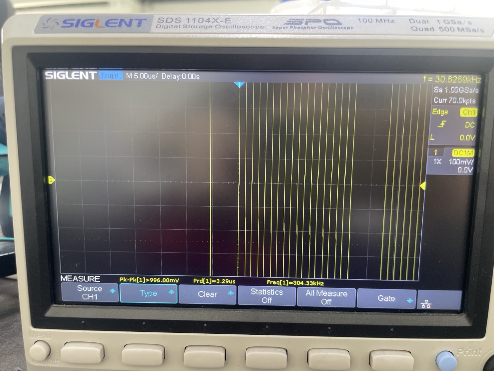
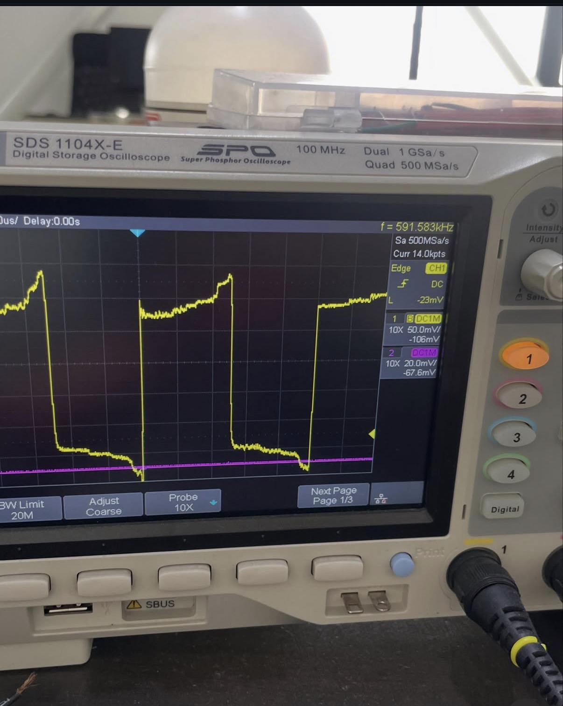
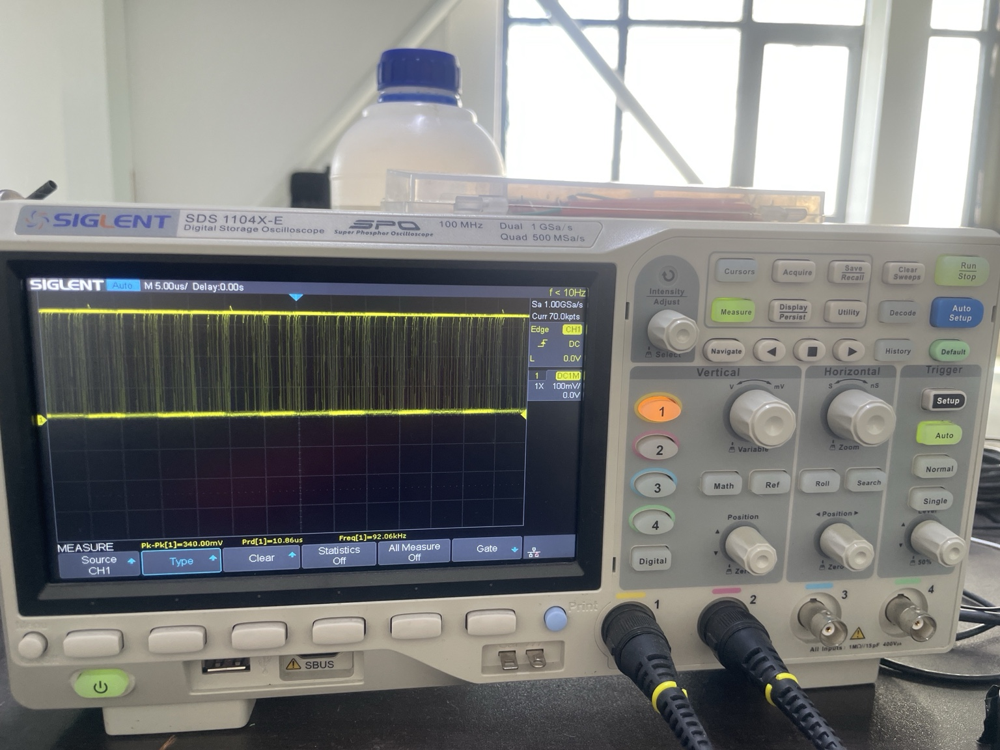
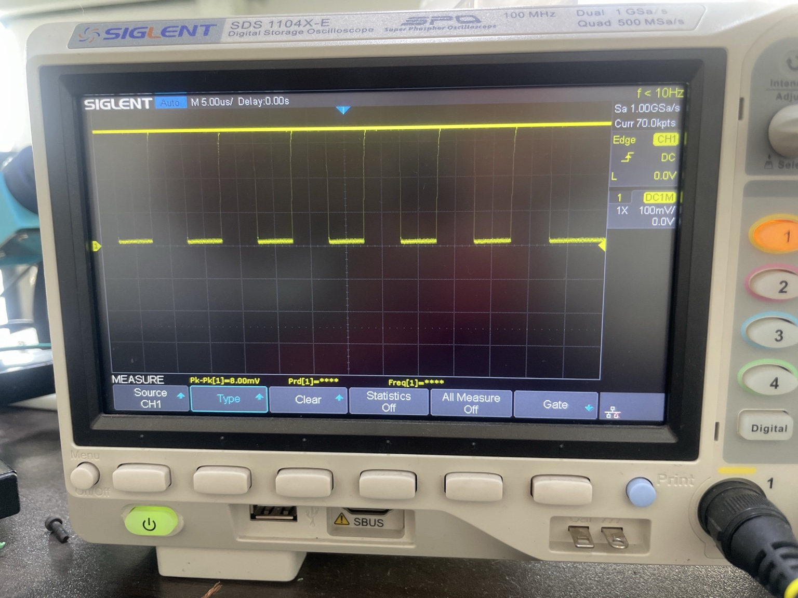

# I²C Communication Reliability and EMI Testing with MPU6050

**Arduino UNO · MPU6050 (GY-521) · Oscilloscope · Pull-up resistors · ESP32-S3 (exploratory) · Stepper motor EMI (planned)**

## Overview

This project investigates how reliably a microcontroller can communicate with an MPU6050 inertial sensor over the I²C bus. The initial milestone was to establish communication, identify the device, and collect repeatable acceleration data. The broader goal is to examine how requested bus speed, pull-up resistance, and electrical noise from a nearby stepper motor driver influence I²C signal quality and successful data transfers.

**Current outcome:** The Arduino UNO detected the MPU6050 at `0x68` and successfully read three-axis acceleration registers. Clock-speed and resistor trials were explored, but the maximum stable speed and any EMI-induced error rate **have not yet been verified**.

## Research question and objectives

**Research question:** How do I²C clock frequency, pull-up resistance, and electromagnetic interference affect communication reliability between a microcontroller and an MPU6050 sensor?

1. Establish a working UNO–MPU6050 I²C connection and confirm the slave address.
2. Read and record raw accelerometer data as evidence of successful communication.
3. Change the requested I²C clock and examine the actual SCL waveform with an oscilloscope.
4. Investigate the effect of pull-up resistors on the bus's electrical behavior.
5. In a future controlled experiment, compare communication errors and waveforms with a nearby stepper driver disabled and enabled.
6. Explore whether the setup can be ported to an ESP32-S3; this is not yet validated.

## Why the MPU6050?

The MPU6050 is a practical test device for this investigation because it provides a straightforward I²C interface and six-axis inertial sensing (three-axis accelerometer plus three-axis gyroscope). Its acceleration registers can be read repeatedly without requiring complex external hardware. The sensor's known I²C address and register map make it possible to distinguish device detection, register access, and data-transfer failures. It is inexpensive, compact, and commonly available as a GY-521 breakout, making it suitable for breadboard prototyping. **The project tests the communication link; it is not an assessment of the sensor's motion-measurement accuracy.**

## Why this problem matters

I²C uses shared SDA and SCL lines with open-drain signaling and pull-up resistors. Bus capacitance and pull-up values affect how quickly the lines rise. Longer wires and electrically noisy equipment can complicate signal integrity. A bus may work at one speed or wiring configuration yet become less reliable when conditions change. Understanding this behavior is relevant to embedded systems that connect sensors to microcontrollers near motors and switching electronics.

## Equipment

| Component | Role |
|---|---|
| Arduino UNO | I²C master and Serial Monitor output |
| MPU6050 / GY-521 breakout | I²C slave and repeatable data source |
| Breadboard and jumper wires | Prototype connections |
| Pull-up resistors (3.3 kΩ and 5.6 kΩ explored) | Investigate SDA/SCL rise behavior |
| Oscilloscope | Observe SCL timing and waveform shape |
| ESP32-S3 board | Exploratory alternative controller, unverified |
| NEMA17 motor + microstep driver | Proposed electrical noise source, not yet characterized |

## Connection and operation

| Arduino UNO | MPU6050 breakout |
|---|---|
| A4 (SDA) | SDA |
| A5 (SCL) | SCL |
| GND | GND |
| 3.3 V | VCC, **only for a breakout verified to support this supply** |

The exact breakout's supply and SDA/SCL pull-up voltage must be verified. The bare MPU6050 is not 5 V tolerant. A level shifter may be needed if I²C lines are pulled up to 5 V. Any added SDA and SCL pull-ups must connect separately to a safe I²C logic rail; account for onboard pull-ups.

The UNO uses Arduino's `Wire` library. The sketch wakes the MPU6050 by writing `0x00` to power-management register `0x6B`, reads six bytes beginning at accelerometer register `0x3B`, and prints signed 16-bit AX, AY, AZ values at 115200 baud. The serial baud rate is **not** the I²C clock speed. See [`arduino_uno/uno_mpu6050.ino`](arduino_uno/uno_mpu6050.ino).

## Experimental method

**Phase 1 — Device detection (completed).** Connect the UNO and breakout, run an I²C scanner, and check the 7-bit address. The detected address was `0x68`.

**Phase 2 — Sensor readout (completed).** Read acceleration registers and inspect the three raw channels in Serial Monitor. Thirteen recorded samples are provided in [`docs/accelerometer_samples.csv`](docs/accelerometer_samples.csv).

**Phase 3 — Bus speed (exploratory).** Request a bus clock using `Wire.setClock(200000)`, then probe SCL with an oscilloscope. A 200 kHz clock corresponds to a nominal period of 5 µs. The requested setting alone is not a measured frequency; SCL occurs in transaction bursts.

**Phase 4 — Pull-ups (exploratory).** Experiment with resistor values and observe changes in waveform rise behavior. The 3.3 kΩ and 5.6 kΩ values were used in experiments, but a controlled A/B comparison and corresponding waveforms are not yet archived.

**Phase 5 — EMI (planned).** After verifying motor-driver wiring and current limits, compare identical I²C test conditions with the driver off/on and at controlled wire separations. Measure read failures and SCL/SDA rise times. No EMI effect is claimed without those results.

## Results

### Confirmed sensor communication

- **Detected 7-bit I²C address:** `0x68`.
- **Observed:** AX, AY, AZ raw values in Serial Monitor.
- **Dataset:** 13 stationary-orientation samples transcribed from a previously shared Serial Monitor image.

| Axis | Mean (raw counts) | Minimum | Maximum | Sample standard deviation |
|---|---:|---:|---:|---:|
| AX | 107.1 | 4 | 220 | 74.1 |
| AY | 233.8 | 120 | 356 | 53.8 |
| AZ | 14,984.0 | 14,772 | 15,192 | 114.0 |

AX and AY are relatively close to zero compared with AZ. This is consistent with a stationary sensor whose Z axis is oriented substantially along gravity, **but the exact orientation and accelerometer full-scale setting were not independently documented**. These values are raw register counts, not calibrated acceleration in g or m/s². A relatively stable AZ value supports the observation that data was being read consistently; **13 samples are not sufficient to establish a communication error rate or sensor accuracy**.

### Clock and resistor observations — approximate

- Requested I²C clock: **200 kHz** in the sketch.
- Approximate SCL observations previously reported: **178–200 kHz**; matching saved scope traces are not yet included.
- Pull-up values explored: **3.3 kΩ and 5.6 kΩ**; a **304.33 kHz** automatic frequency readout is visible in an archived SCL oscilloscope photograph, although the corresponding firmware setting and exact resistor wiring are unknown.
- **Maximum verified stable I²C clock: not determined.** A pull-up resistor cannot by itself establish a new programmed SCL clock; it mainly affects electrical rise behavior.

### Troubleshooting

Early attempts showed unsuccessful device detection and I²C error messages (`2` and `4`), along with suspected intermittent contact at an unsoldered sensor header. Communication later succeeded after connection troubleshooting. The specific root cause was not conclusively isolated.

### What has not been demonstrated

No verified ESP32-S3 sensor output, controlled pull-up comparison, motor-on/off oscilloscope comparison, measured EMI-related error rate, or maximum reliable bus speed is available yet. The relevant code is labeled draft/unverified.

## Oscilloscope captures

The following are original oscilloscope photographs, not simulated signals. The probe was reported to be connected to Arduino UNO **A5/SCL**. The exact pull-up wiring, physical probe attenuation, and firmware settings for each capture were not recorded.



*Figure 1 — SCL investigation with external pull-up resistors. The bottom automatic measurement reads **304.33 kHz**, **3.29 µs** period, and **996 mV** peak-to-peak. A separate top-right readout shows **30.6269 kHz**, so the differing instrument measurements require investigation. CH1 displays 1X, but the physical probe switch position is unknown.*



*Figure 2 — Another clock waveform capture. The top-right display reads **591.583 kHz**. The signal shows non-ideal edges; its association with a successful I²C transaction has not been established.*



*Figure 3 — Captured switching activity with bottom readouts of **92.06 kHz**, **10.86 µs**, and **340 mV** peak-to-peak. The instrument's top-right frequency indicator reads <10 Hz, demonstrating that measurement methods or acquisition windows may differ.*



*Figure 4 — Capture without a valid automatic period/frequency result (`****`); not evidence of a measured I²C clock frequency.*

**Interpretation:** These screenshots document that SCL timing and waveform shape were investigated. They do **not** independently prove the maximum stable I²C clock, the correct bus voltage, or an improvement attributable to a particular resistor. The resistor values explored were 3.3 kΩ and 5.6 kΩ, but their exact placement in these captures was not recorded.

## Discussion and conclusions

The first objective—establishing UNO-to-MPU6050 communication—was achieved. Detection at `0x68` and repeated acceleration-register values show that the microcontroller could address the device and retrieve sensor data. Early errors also highlight the importance of stable physical connections in breadboard experiments. The frequency and pull-up trials helped frame the next stage of signal-integrity investigation, but available records do not support a numerical claim about optimal resistance, maximum bus speed, or EMI susceptibility. Future experiments should compare controlled conditions and count successful/failed reads rather than infer reliability from a single waveform.

## Future work — FPGA-based I²C verification

As a longer-term extension, an FPGA could be used to implement and verify a custom I²C controller or a passive protocol monitor. This would allow hardware-level checks of SCL timing, START/STOP conditions, and ACK/NACK responses under the same test conditions used with the Arduino. FPGA reconfigurability would also support iterative design corrections before considering a fixed-function hardware implementation. **This is a proposed extension, not part of the completed experiments.**

## Reproducibility and future measurements

For every test, log the controller, requested clock, **measured** SCL frequency, SCL rise time, bus voltage, pull-up network including any onboard resistors, wire length, number of attempted/successful reads, and whether the motor driver was active. Save oscilloscope captures with matching filenames and note the motor-to-bus distance. See [`docs/measurement_log.csv`](docs/measurement_log.csv) and [`docs/experimental_results.md`](docs/experimental_results.md).

## Repository structure

```text
arduino_uno/           I²C scanner and MPU6050 readout sketch
esp32_s3/              ESP32-S3 draft (unverified)
stepper_emi/           Motor STEP/DIR draft (unverified)
docs/                  Experimental notes, raw readings, measurement log
images/                Original oscilloscope photographs
README.md              Project rationale, methodology, results, limitations
LICENSE                MIT license
```

## Safety note

The motor driver requires its own compatible power supply and verified current-limit settings. Do not connect its 9–42 V supply to Arduino pins. Confirm motor coil pairs and optocoupler input wiring before applying power; do not reconnect the motor while powered. Grounded oscilloscope probe clips must only be used on appropriately verified reference points.

## License

MIT. See [`LICENSE`](LICENSE).
